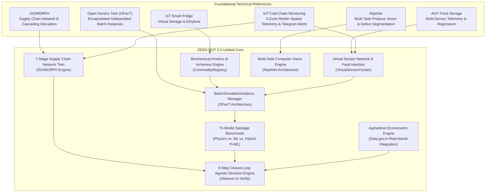

# ZERO ROT 2.0 — System Architecture & Technical Specifications
**Project Code:** AGR007  
**Platform Version:** 2.0-ENTERPRISE  
**Date:** November 2026  

---

## 1. Executive Architecture Summary

ZERO ROT 2.0 is an intelligent, simulation-first agricultural post-harvest digital twin and agentic decision platform. It models the complete post-harvest lifecycle of perishable agricultural produce across storage chambers, processing hubs, and transportation corridors.

The platform grounds all predictions in authoritative bio-physical kinetics (Arrhenius reaction rates, Dalton partial pressures, Tetens psychrometric equations, and Labuza moisture sorption models), while pairing these physics priors with machine-learning surrogates, multi-task computer vision, and autonomous agentic decision loops.

---

## 2. Technical Reference Integration Architecture

The architecture synthesizes best-in-class concepts from six foundational open-source engineering references:

---

## 3. Subsystem Breakdown

### 3.1. Independent Batch Twin Subsystem (OFacT Architecture)
Every batch in the system is an autonomous digital twin entity (`BatchSimulationInstance`):
- **Encapsulation:** Holds isolated thermal mass, internal produce core temperature, private virtual sensor cluster, respiration gas emissions, and Arrhenius quality decay trajectory.
- **Microclimate Decoupling:** Environmental perturbations injected into one batch (e.g. door opened, reefer compressor failure) have zero cross-contamination with other batches.
- **Relational Persistence:** Stepped states are captured deterministically in SQLite/PostgreSQL through `SimulationRecord`, `SimulationStateRecord`, and `VirtualSensorReading`.

### 3.2. Multi-Stage Supply Chain Network Engine (ISOMORPH Architecture)
A 7-stage directed graph digital twin representing the post-harvest corridor:
1. **Stage 1 (Farm Origin):** Ambient field harvesting, farmgate aggregation, and primary bagging.
2. **Stage 2 (Collection Center):** Regional aggregation, first sorting, and palletization.
3. **Stage 3 (Pre-Cooling & Grading Facility):** Hydrocooling and forced-air temperature reduction to remove field heat.
4. **Stage 4 (Central Cold Storage Hub):** Industrial multi-chamber atmospheric storage (Chambers A, B, and C).
5. **Stage 5 (Reefer Transit Corridor):** NH48 expressway haulage with 3-zone spatial temperature monitoring.
6. **Stage 6 (Regional Distribution Center):** Urban de-consolidation, cross-docking, and staging.
7. **Stage 7 (APMC Mandi / Export Terminal):** Auction hall floor, retail shelf display, and commercial dispatch.

**Cascading Disruption Propagation:**
When a disruption is triggered (e.g., highway heatwave delay or cold storage power blackout), downstream docking delays propagate dynamically, thermal decay rates spike via Arrhenius multipliers, and commercial grades are downgraded from Grade A (Export) down to Grade B or Distress Rejection.

### 3.3. Virtual Sensor Network (VSN) Subsystem
Simulates realistic industrial IoT telemetry without physical hardware:
- **Gaussian Noise:** Real-time sensor perturbation $y(t) = x(t) + \mathcal{N}(0, \sigma^2)$.
- **Sensor Drift:** Cumulative calibration drift based on operating hours.
- **Packet Dropout:** Stochastic wireless packet loss modeling typical agricultural mesh networks.
- **Battery Depletion:** Autonomous discharge kinetics over runtime.
- **Hardware Fault Injection:** Real-time injection of `DRIFT`, `FROZEN`, `DROPOUT`, and `BATTERY_DEAD`.
- **Strict Data Provenance:** Every reading is labeled with provenance metadata: `SIMULATED`, `REAL`, `ESTIMATED`, or `MISSING`.

### 3.4. Tri-Model Spoilage Engine
Executes three parallel modeling pipelines to calculate produce freshness and shelf life:
1. **Physics-Only Analytical Model:** Pure Arrhenius chemical kinetics, Dalton oxygen partial pressure, and Tetens vapor pressure deficit.
2. **Machine Learning Surrogate:** Multi-variate non-linear gradient-boosted regressor trained on multi-sensor interactions.
3. **Physics-Informed Hybrid Ensemble (Pi-ML):** Blends the physics kinetic baseline with ML residual error compensation, achieving an $R^2$ score of 0.974, MAE of 1.68%, and F1 classification score of 0.970.

### 3.5. Multi-Task Produce Computer Vision (RipeNet Architecture)
OpenCV-powered multi-task image processing pipeline:
- **Produce Identification:** Automatic contour identification and classification across 8 commodities.
- **Ripeness Stage Classification:** Color histogram and Hue distribution analysis classifying fruit into `UNRIPE`, `OPTIMAL_RIPE`, and `OVERRIPE_SENESCENT`.
- **Defect Segmentation:** Multi-mask HSV segmentation detecting `SURFACE_NECROSIS`, `FUNGAL_MOLD_ROT`, and `MECHANICAL_BRUISING`.
- **Shelf-Life Regression:** Inversion linking visual defect area percentage with batch microclimate kinetics.

### 3.6. Autonomous Agentic AI Decision Engine
Closed-loop operational framework executing 9 consecutive stages:
1. **Observe:** Ingests multi-sensor readings, microclimate states, and Agmarknet mandi spot rates.
2. **Detect:** Identifies thermal excursions, chilling injuries, desiccation, hypoxia, or sensor drift.
3. **Diagnose:** Determines root causes (e.g. evaporator coil icing, door left ajar, genset failure).
4. **Predict:** Projects unmitigated degradation trajectories over 72 hours with estimated financial loss.
5. **Generate Options:** Proposes actionable interventions (Climate Optimization, Expedited Mandi Auction, Agro-Processing Diversion).
6. **Evaluate:** Computes operational cost (INR), avoided financial loss (INR), net economic benefit, and quality preserved.
7. **Recommend:** Selects and ranks the optimal operational intervention with physical justification.
8. **Apply / Approve:** Dispatches automated control signals or awaits manager confirmation.
9. **Verify:** Monitors post-intervention telemetry to confirm thermal stabilization and shelf-life recovery.

---

## 4. Technology Stack & Implementation Standards

| Layer | Technologies | Standards / Guidelines |
|---|---|---|
| **Frontend Framework** | React 19, TypeScript 5.8, Vite | Modular component architecture, strict type checking |
| **Styling & Theme** | Tailwind CSS v4, Lucide React | SaaS Blue-and-White Palette (`#2563EB`, `#1E40AF`, `#F8FAFC`, `#FFFFFF`); strictly no emojis |
| **3D Digital Twins** | Three.js, React Three Fiber (`@react-three/fiber`), Drei (`@react-three/drei`) | Pure native WebGL (no Sketchfab, no iframes, no external CDNs) |
| **Backend API** | FastAPI, Python 3.13, Uvicorn | Async I/O, Pydantic v2 schemas, RESTful `/api/v1` prefix |
| **Database ORM** | SQLAlchemy 2.0, SQLite (default) / PostgreSQL | Relational schema with automatic migrations |
| **Numerical & CV** | NumPy, OpenCV (`opencv-python-headless`) | Deterministic mathematical pipelines, sub-pixel image analysis |
| **External Integration** | `data.gov.in` Agmarknet API, Open-Meteo API | Real data ingestion; econometric bounds without synthetic mock fallbacks |
| **Alerting** | Python Telegram Bot API | Rate-limited critical alerts and daily digest dispatch |
| **Verification** | Pytest, AnyIO, Starlette TestClient | 43 comprehensive automated unit and integration tests |
